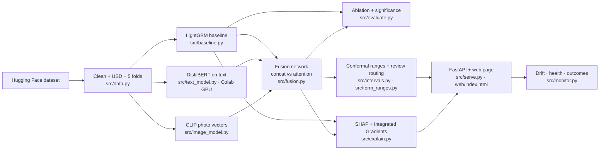

# Airbnb Price Estimator

Predicts a listing's nightly price from its details, description and photo. It gives a **price
range with a coverage guarantee** and **sends uncertain listings to a human**, explains each
price, and runs as a monitored web service.

Data: [MongoDB/airbnb_embeddings](https://huggingface.co/datasets/MongoDB/airbnb_embeddings),
5,555 listings in 12 markets, 7 currencies converted to USD at 2019 rates. Every number below
is **out-of-fold** (5-fold cross-validation) unless stated, and comes from a script in this repo.

## Results

| Model                                   | MdAPE  | MAE    | Within 10% | Within 20% |
| --------------------------------------- | ------ | ------ | ---------- | ---------- |
| Naive: market median                    | 44.83% | $66.96 | 12.94%     | 24.36%     |
| **LightGBM baseline** (tabular)         | 26.98% | $45.86 | 19.87%     | 38.27%     |
| Text only (multilingual DistilBERT)     | 36.25% | $58.71 | 14.82%     | 29.20%     |
| Stacked LightGBM (table + text + photo) | 27.09% | $46.03 | 20.13%     | 38.27%     |
| Fusion NN, attention                    | 26.84% | $45.31 | 20.05%     | 39.19%     |
| **Fusion NN, concatenation** (best)     | 26.42% | $45.15 | 20.11%     | 39.51%     |

**The photos and descriptions don't significantly improve accuracy.** The best model beats the
baseline by 0.56 points of MdAPE. Paired bootstrap (2,000 resamples) with Holm correction:
p = 0.105. The same features in a second LightGBM run move MdAPE by 0.4 points, so the gain is
within noise. ([reports/evaluation.md](reports/evaluation.md))

**The ranges keep their promise, and adaptive ranges are fair across listings.**
([reports/intervals.md](reports/intervals.md))

| 80% price range                             | Coverage  | Hardest third of listings | Worst large market |
| ------------------------------------------- | --------- | ------------------------- | ------------------ |
| Same ± for everyone                         | 79.2%     | 68.4%                     | 64.3% (Rio)        |
| **Adaptive** (scaled by a difficulty model) | **79.4%** | **84.8%**                 | **77.3%**          |

**Human review.** Sending the 20% most uncertain listings to an analyst lowers the error on
the automatically priced 80% from 26.4% to 24.3% MdAPE. The reviewed group holds 1.6× its
share of the misses over 50%.

**Explanations.** SHAP on LightGBM: room type, market, guests and neighbourhood drive price.
Integrated Gradients on the fusion network: its average 6% adjustment comes mostly from the
photo (48%) and description (35%). ([reports/explain.md](reports/explain.md))

**Serving and monitoring.** p95 latency is 28 ms on a laptop CPU. Replaying listings through
the service caught **training-serving skew**: a host filling in only the web form gets less
accurate prices (18% → 28% MdAPE in the replay). The ranges, sized for full listing data,
covered 72% instead of 80%, and the review rate collapsed to 4%. Both alerts fired. Phase 10
re-sized the ranges on out-of-fold form-only errors:
[reports/form_ranges.md](reports/form_ranges.md) TBD (fill in after running
`python -m src.form_ranges`).

## How it works



| Phase | Module                                   | What it does                                                          |
| ----- | ---------------------------------------- | --------------------------------------------------------------------- |
| 1     | `src/data.py`                            | load, flatten, validate, convert to USD, price-stratified folds       |
| 2     | `src/eda.py`                             | distributions, outliers, Spearman, amenity effects, embedding probes  |
| 3     | `src/baseline.py`                        | features + LightGBM on log price, early stopping, MLflow              |
| 4     | `src/text_model.py`                      | fine-tune multilingual DistilBERT (AdamW, warmup, fp16) on Colab      |
| 5     | `src/image_model.py`                     | check the dataset's CLIP vectors, zero-shot photo scores              |
| 6     | `src/fusion.py`                          | residual fusion network: concatenation vs attention, modality dropout |
| 7     | `src/evaluate.py`                        | stacked ablation, paired bootstrap, t-test, Holm correction           |
| 8     | `src/intervals.py`, `src/explain.py`     | conformal ranges, difficulty model, routing, SHAP, IG                 |
| 9     | `src/serve.py`, `src/monitor.py`, `web/` | API, web page, PSI drift, outcome tracking, Docker                    |
| 10    | `src/form_ranges.py`                     | ranges re-sized for what the web form actually sends                  |

Each phase has a write-up in [`docs/`](docs) and a report in [`reports/`](reports).

## Design decisions

- **No leakage.** Folds are fixed in Phase 1 and every learned step is fit inside the training
  folds: outlier limits, PCA, ridge strength, range sizes, typical values. Stacked inputs are
  out-of-fold. A regression test guards against other models' outputs leaking into the table
  features (a real bug, found and fixed in Phase 7).
- **Log-price target, percentage metrics.** Prices span $10 to $5,000+. MdAPE and within-10%
  match how a pricing team judges error better than RMSE does.
- **Evidence over leaderboards.** Every comparison is paired on the same listings and corrected
  for multiple tests. "No significant difference" is reported as such.
- **Ranges, not just numbers.** Split conformal prediction gives coverage without assuming
  normal errors. The difficulty model makes ranges narrow where the model is reliable.
- **Missing inputs are normal.** Training randomly hides the text or photo (modality dropout),
  so the service works with or without them.

## Run it

```bash
python -m venv .venv && .venv\Scripts\activate      # macOS/Linux: source .venv/bin/activate
pip install -r requirements.txt
pytest                                              # 111 tests, offline, synthetic data

python -m src.data audit && python -m src.data build     # Phase 1
python -m src.eda                                         # Phase 2
python -m src.baseline                                    # Phase 3
# Phase 4 on a GPU: notebooks/phase4_text_colab.ipynb, unzip results here, then:
python -m src.text_model log
python -m src.image_model verify && python -m src.image_model train   # Phase 5
python -m src.fusion train                                # Phase 6
python -m src.evaluate                                    # Phase 7
python -m src.intervals && python -m src.explain          # Phase 8
python -m src.serve build                                 # Phase 9
python -m src.form_ranges                                 # Phase 10
python -m src.serve run                                   # http://127.0.0.1:8000
python -m src.monitor simulate --n 300 --fresh --form-only
mlflow ui --backend-store-uri sqlite:///mlflow.db         # every run's parameters and metrics
```

Docker (after the steps above, because the image copies `models/`):

```bash
docker build -t airbnb-price .
docker run -p 8000:8000 airbnb-price
```

Everything runs on a CPU except Phase 4. All settings are in [`config.yaml`](config.yaml).
CI runs ruff and the tests on every push.

## Limitations and next steps

- **Small data.** 5,555 listings over 12 markets; Kauai has 67. More data per market would help
  more than bigger models.
- **2019 prices.** The dataset is a snapshot; fixed 2019 exchange rates are used.
- **No hyperparameter search.** Settings are fixed in `config.yaml`. Optuna inside the folds is
  the obvious next step, but Phase 7 suggests the gains would be small.
- **Scaling.** Polars handles this data in under a second, so Spark adds nothing at this size.
  At millions of listings, Phase 1 cleaning and batch scoring would move to Polars streaming or
  PySpark with the same logic.
