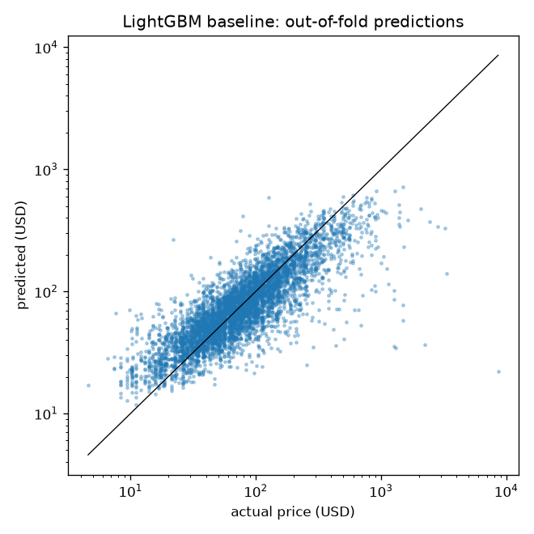

# Baseline: LightGBM on structured features
_Generated by `python -m src.baseline`. Do not efit by hand._

5555 listings, 5-fold CV on the Phase 1 folds, target `log1p(price)`, 61 features. Metrics are on out-of-fold predictions in USD.

## 1. Overall
| model                | mae_usd | mdape_pct | within_10_pct | within_20_pct | r2_log |
|----------------------|---------|-----------|---------------|---------------|--------|
| naive: market median | 66.96   | 44.83     | 12.94         | 24.36         | 0.2454 |
| LightGBM baseline    | 45.86   | 26.98     | 19.87         | 38.27         | 0.6756 |

MAE across folds: $45.86 ± 4.14 (mean ± std).

## 2. Per fold
| fold | train_rows | valid_rows | best_iteration | mae_usd | mdape_pct | within_10_pct | within_20_pct | r2_log |
|------|------------|------------|----------------|---------|-----------|---------------|---------------|--------|
| 0    | 4354       | 1111       | 482            | 39.94   | 25.13     | 20.79         | 40.86         | 0.7087 |
| 1    | 4354       | 1111       | 721            | 49.45   | 28.3      | 18.54         | 36.36         | 0.6746 |
| 2    | 4355       | 1111       | 264            | 45.31   | 26.41     | 21.69         | 39.6          | 0.6689 |
| 3    | 4360       | 1111       | 781            | 50.16   | 27.97     | 18.72         | 36.72         | 0.6617 |
| 4    | 4354       | 1111       | 427            | 44.45   | 26.54     | 19.62         | 37.8          | 0.665  |

## 3. Per Market
| market         | rows | mae_usd | mdape_pct | within_10_pct | within_20_pct | r2_log |
|----------------|------|---------|-----------|---------------|---------------|--------|
| Istanbul       | 660  | 38.22   | 36.98     | 15.76         | 29.09         | 0.4252 |
| Montreal       | 648  | 28.85   | 26.78     | 21.6          | 38.43         | 0.5099 |
| Barcelona      | 632  | 49.91   | 28.83     | 18.2          | 34.81         | 0.6058 |
| Hong Kong      | 619  | 37.87   | 24.73     | 21.97         | 41.03         | 0.4758 |
| Sydney         | 609  | 47.23   | 23.48     | 22.0          | 42.69         | 0.6693 |
| New York       | 607  | 42.42   | 21.92     | 21.75         | 45.96         | 0.6497 |
| Rio De Janeiro | 603  | 69.07   | 38.74     | 13.93         | 27.53         | 0.5837 |
| Porto          | 554  | 23.19   | 23.88     | 20.94         | 41.88         | 0.5709 |
| Oahu           | 253  | 65.94   | 20.25     | 26.09         | 49.8          | 0.7068 |
| Maui           | 153  | 94.04   | 23.96     | 15.03         | 38.56         | 0.4661 |
| The Big Island | 139  | 73.08   | 25.76     | 24.46         | 42.45         | 0.5667 |
| Kauai          | 67   | 75.48   | 24.26     | 28.36         | 41.79         | 0.7295 |
|                | 6    | 32.25   | 28.37     | 16.67         | 33.33         | 0.5639 |

## 4. Per room type
| room_type       | rows | mae_usd | mdape_pct | within_10_pct | within_20_pct | r2_log |
|-----------------|------|---------|-----------|---------------|---------------|--------|
| Entire home/apt | 3489 | 54.25   | 25.52     | 20.55         | 40.18         | 0.652  |
| Private room    | 1983 | 31.06   | 29.62     | 19.06         | 35.45         | 0.462  |
| Shared room     | 83   | 47.12   | 44.21     | 10.84         | 25.3          | 0.1025 |

## 5. Feature importance (gain, mean over folds, top 20)
| feature                 | gain_pct |
|-------------------------|----------|
| room_type               | 19.86    |
| market                  | 11.75    |
| accommodates            | 9.91     |
| longitude               | 9.5      |
| bathrooms               | 5.59     |
| latitude                | 4.77     |
| neighbourhood           | 4.23     |
| bedrooms                | 3.26     |
| dist_centre_km          | 3.13     |
| days_since_last_review  | 2.7      |
| minimum_nights          | 2.26     |
| days_since_first_review | 2.14     |
| amenities_count         | 2.07     |
| number_of_reviews       | 1.72     |
| host_listings_count     | 1.54     |
| rs_rating               | 1.35     |
| beds                    | 1.1      |
| amen_air_conditioning   | 1.07     |
| maximum_nights          | 0.91     |
| guests_included         | 0.87     |

## 6. Final model
Trained on all rows with 535 trees (mean best iteration). Saved to `models/baseline_lightgbm.txt`.
