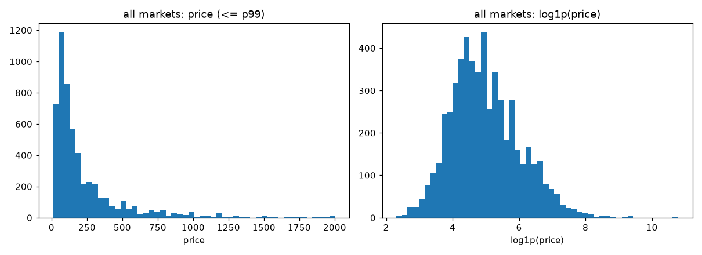
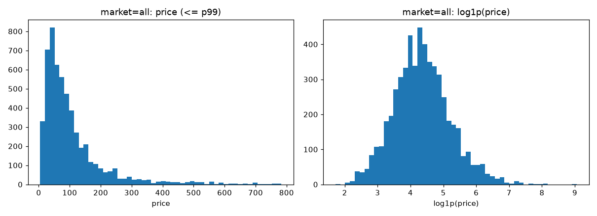

# Data audit
_Generated by `python -m src.data`. Do not edit by hand._

Raw rows: **5555**, columns: 43, seed: 42

## 1. Data types of money fields
| column           | dtype   |
|------------------|---------|
| price            | Int64   |
| security_deposit | Float64 |
| cleaning_fee     | Float64 |
| extra_people     | Int64   |
| weekly_price     | Float64 |
| monthly_price    | Float64 |

## 2. Rows per country and market (median in local currency and in USD)
| country       | market                | rows | median_local | median_usd |
|---------------|-----------------------|------|--------------|------------|
| Turkey        | Istanbul              | 660  | 179.0        | 31.53      |
| Canada        | Montreal              | 648  | 75.0         | 56.52      |
| Spain         | Barcelona             | 632  | 60.0         | 67.17      |
| Australia     | Sydney                | 609  | 132.0        | 91.77      |
| United States | New York              | 607  | 110.0        | 110.0      |
| Brazil        | Rio De Janeiro        | 603  | 257.0        | 65.16      |
| Hong Kong     | Hong Kong             | 600  | 561.0        | 71.6       |
| Portugal      | Porto                 | 554  | 59.0         | 66.05      |
| United States | Oahu                  | 253  | 142.0        | 142.0      |
| United States | Maui                  | 153  | 228.0        | 228.0      |
| United States | The Big Island        | 139  | 120.0        | 120.0      |
| United States | Kauai                 | 67   | 239.0        | 239.0      |
| China         | Hong Kong             | 19   | 393.0        | 50.16      |
| United States |                       | 2    | 137.0        | 137.0      |
| Brazil        | Other (International) | 2    | 591.5        | 149.97     |
| Spain         |                       | 1    | 24.0         | 26.87      |
| Australia     |                       | 1    | 254.0        | 176.59     |
| Canada        |                       | 1    | 25.0         | 18.84      |
| Brazil        |                       | 1    | 116.0        | 29.41      |
| United States | Other (Domestic)      | 1    | 128.0        | 128.0      |
| Turkey        | Other (International) | 1    | 501.0        | 88.26      |
| Portugal      | Other (International) | 1    | 99.0         | 110.83     |

Recommended market (largest, if >= 1000 rows, else all): **all**

## 3. Image URL check
Failed 10 of 50 (20%). Use provided image embeddings: **False**

## 4. Raw price distribution (all markets, mixed currencies)
| statistic  | value      |
|------------|------------|
| count      | 5555.0     |
| null_count | 0.0        |
| mean       | 278.766157 |
| std        | 842.215531 |
| min        | 9.0        |
| 1%         | 18.0       |
| 5%         | 31.0       |
| 25%        | 70.0       |
| 50%        | 129.0      |
| 75%        | 280.0      |
| 95%        | 903.0      |
| 99%        | 2002.0     |
| max        | 48842.0    |

## 5. Missing values (raw, top 25)
| column                | missing | pct  |
|-----------------------|---------|------|
| monthly_price         | 4899    | 88.2 |
| weekly_price          | 4841    | 87.1 |
| security_deposit      | 2084    | 37.5 |
| cleaning_fee          | 1531    | 27.6 |
| first_review          | 1388    | 25.0 |
| last_review           | 1388    | 25.0 |
| image_embeddings      | 924     | 16.6 |
| beds                  | 13      | 0.2  |
| bathrooms             | 10      | 0.2  |
| bedrooms              | 5       | 0.1  |
| _id                   | 0       | 0.0  |
| listing_url           | 0       | 0.0  |
| name                  | 0       | 0.0  |
| summary               | 0       | 0.0  |
| space                 | 0       | 0.0  |
| description           | 0       | 0.0  |
| neighborhood_overview | 0       | 0.0  |
| notes                 | 0       | 0.0  |
| transit               | 0       | 0.0  |
| access                | 0       | 0.0  |
| interaction           | 0       | 0.0  |
| house_rules           | 0       | 0.0  |
| property_type         | 0       | 0.0  |
| room_type             | 0       | 0.0  |
| bed_type              | 0       | 0.0  |

## 6. Chosen market: **all**

All prices are converted to **USD** with 2019 average exchange rates (see `currency` in config.yaml). `price_local` keeps the original value.

## 7. Cleaning steps
| step                              | rows |
|-----------------------------------|------|
| raw                               | 5555 |
| market = all                      | 5555 |
| drop missing / non-positive price | 5555 |
| drop duplicate listings           | 5555 |

Leakage columns removed: availability, calendar_last_scraped, cleaning_fee, extra_people, listing_url, monthly_price, reviews, security_deposit, weekly_price.

Price mentions in the text were replaced with `[PRICE]`. The provided `text_embeddings` come from the raw `space` field and can't be scrubbed, so treat them as a possible weak leakage source.

## 8. Processed price distribution
| statistic  | value       |
|------------|-------------|
| count      | 5555.0      |
| null_count | 0.0         |
| mean       | 118.473519  |
| std        | 199.448485  |
| min        | 4.580287    |
| 1%         | 11.098388   |
| 5%         | 18.840907   |
| 25%        | 42.808068   |
| 50%        | 74.0        |
| 75%        | 129.0       |
| 95%        | 346.913237  |
| 99%        | 783.611329  |
| max        | 8604.245574 |

## 9. Outlier rule
Inside each training fold, keep log1p(price) between the fold's 0.01 and 0.99 quantiles. Validation rows are never dropped. Nothing is dropped in Phase 1.

## 10. Folds (stratified on price deciles)
| fold | rows | median_price |
|------|------|--------------|
| 0    | 1111 | 74.341584    |
| 1    | 1111 | 74.609993    |
| 2    | 1111 | 75.0         |
| 3    | 1111 | 72.763909    |
| 4    | 1111 | 72.768763    |

## 11. Embeddings present
text: 5555 / 5555, image: 4631 / 5555

## 12. Top amenities
Wifi, Essentials, Kitchen, TV, Hangers, Hair dryer, Washer, Shampoo, Iron, Laptop friendly workspace, Air conditioning, Heating, Hot water, Smoke detector, Family/kid friendly, Dryer, Elevator, Fire extinguisher, Refrigerator, Internet, First aid kit, Bed linens, Cable TV, Dishes and silverware, Cooking basics, Microwave, Long term stays allowed, Lock on bedroom door, Stove, Free parking on premises
