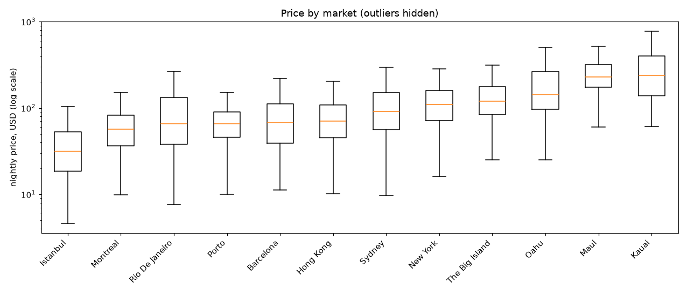
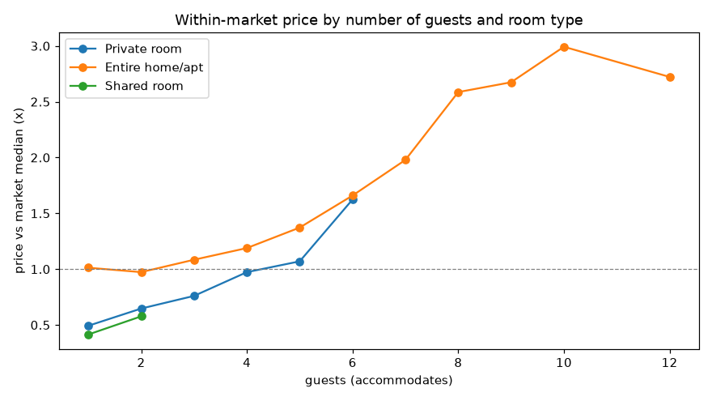
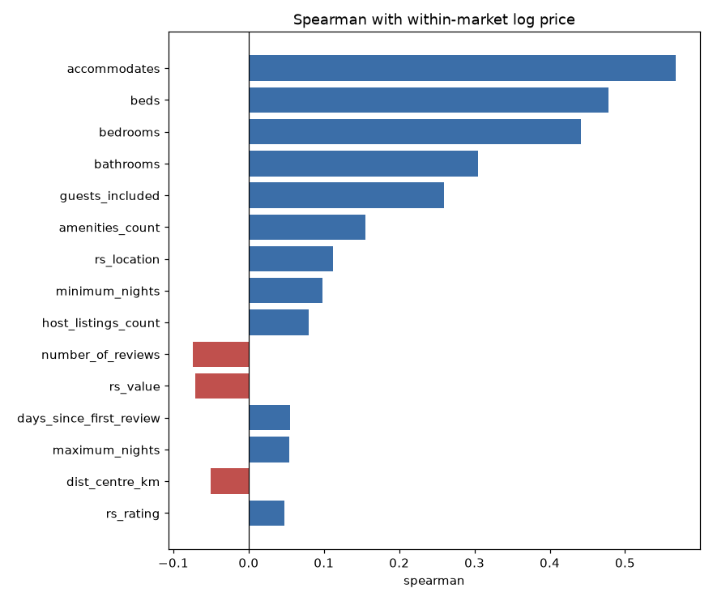
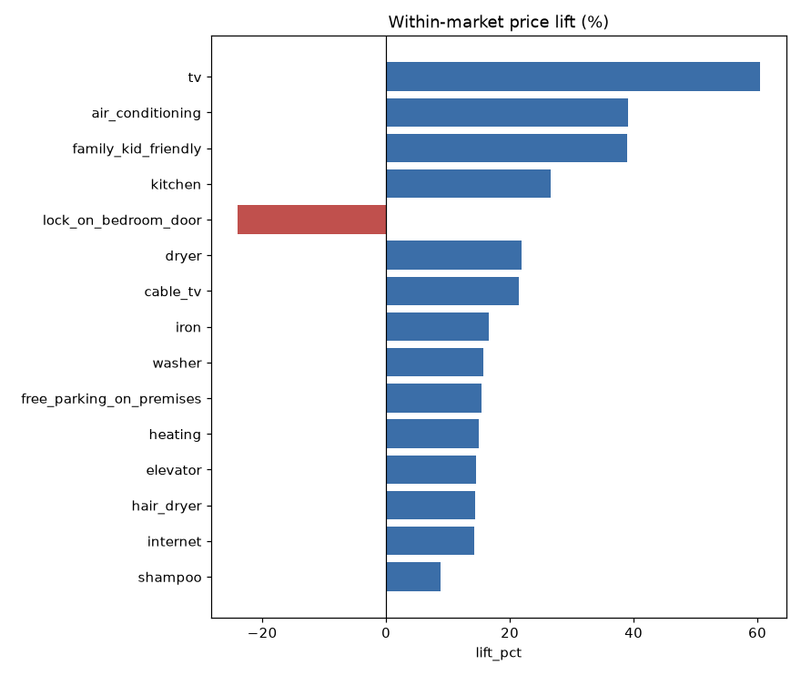

# Exploratory data analysis
_Generated by `python -m src.eda`. Do not edit by hand._

All prices are USD (converted in Phase 1). *Within-market* means relative to the listing's market median, so market-level differences don't count as feature signal.

## 1. Target
- 5555 listings, median **$74.0**, mean $118.47, 1st-99th percentile $11.1-$783.61, max $8604.25.
- Skewness: price 17.93, log price 0.38. Models predict `log_price` and convert back.

## 2. Prices that are extreme for their market
Robust z-score of log price within market above 3.5: **41** listings (0.74%). Not dropped; the fold-wise outlier rule handles training, and these are checked by hand.
| listing_id | market         | room_type       | property_type          | accommodates | bedrooms | currency | price_local | price   | robust_z |
|------------|----------------|-----------------|------------------------|--------------|----------|----------|-------------|---------|----------|
| 20275354   | Istanbul       | Private room    | Apartment              | 1.0          | 1.0      | TRY      | 48842.0     | 8604.25 | 7.35     |
| 32838748   | The Big Island | Entire home/apt | House                  | 10.0         | 5.0      | USD      | 3250.0      | 3250.0  | 5.92     |
| 17103047   | Montreal       | Private room    | House                  | 1.0          | 1.0      | CAD      | 1746.0      | 1315.85 | 5.32     |
| 30310595   | Barcelona      | Entire home/apt | Casa particular (Cuba) | 4.0          | 2.0      | EUR      | 3000.0      | 3358.33 | 5.21     |
| 20692563   | New York       | Entire home/apt | Townhouse              | 7.0          | 4.0      | USD      | 2450.0      | 2450.0  | 5.19     |
| 27835298   | Maui           | Entire home/apt | House                  | 6.0          | 3.0      | USD      | 2060.0      | 2060.0  | 4.84     |
| 24492886   | Istanbul       | Private room    | Hotel                  | 2.0          | 1.0      | TRY      | 7203.0      | 1268.92 | 4.83     |
| 4742607    | Porto          | Entire home/apt | Farm stay              | 16.0         | 9.0      | EUR      | 500.0       | 559.72  | 4.77     |
| 9917859    | Porto          | Entire home/apt | Apartment              | 16.0         | 8.0      | EUR      | 500.0       | 559.72  | 4.77     |
| 14644562   | Hong Kong      | Shared room     | Condominium            | 5.0          | 1.0      | HKD      | 11681.0     | 1490.86 | 4.71     |
| 27593455   | Hong Kong      | Private room    | Serviced apartment     | 2.0          | 1.0      | HKD      | 11681.0     | 1490.86 | 4.71     |
| 23921295   | Montreal       | Entire home/apt | Loft                   | 16.0         | 7.0      | CAD      | 1200.0      | 904.36  | 4.68     |
| 3382961    | Montreal       | Entire home/apt | Loft                   | 6.0          | 3.0      | CAD      | 1190.0      | 896.83  | 4.67     |
| 23700685   | Barcelona      | Private room    | Apartment              | 1.0          | 0.0      | EUR      | 2000.0      | 2238.89 | 4.66     |
| 3920836    | Porto          | Entire home/apt | Cottage                | 16.0         | 6.0      | EUR      | 450.0       | 503.75  | 4.53     |
| 22200454   | Hong Kong      | Entire home/apt | Condominium            | 5.0          | 3.0      | HKD      | 10001.0     | 1276.44 | 4.47     |
| 30327756   | Hong Kong      | Private room    | Bed and breakfast      | 5.0          | 2.0      | HKD      | 10001.0     | 1276.44 | 4.47     |
| 24857815   | Montreal       | Entire home/apt | Guest suite            | 4.0          | 2.0      | CAD      | 950.0       | 715.95  | 4.29     |
| 20955863   | Istanbul       | Entire home/apt | Villa                  | 14.0         | 7.0      | TRY      | 4745.0      | 835.9   | 4.28     |
| 28045781   | Istanbul       | Private room    | Apartment              | 16.0         | 7.0      | TRY      | 4761.0      | 838.72  | 4.28     |

## 3. Price by market
| market                | rows | median_usd | q25_usd | q75_usd |
|-----------------------|------|------------|---------|---------|
| Istanbul              | 660  | 31.5       | 18.5    | 53.0    |
| Montreal              | 648  | 56.5       | 36.2    | 82.9    |
| Barcelona             | 632  | 67.2       | 39.2    | 111.9   |
| Hong Kong             | 619  | 70.2       | 45.1    | 108.2   |
| Sydney                | 609  | 91.8       | 55.6    | 151.6   |
| New York              | 607  | 110.0      | 72.0    | 160.0   |
| Rio De Janeiro        | 603  | 65.2       | 37.8    | 133.4   |
| Porto                 | 554  | 66.0       | 45.9    | 89.6    |
| Oahu                  | 253  | 142.0      | 97.0    | 265.0   |
| Maui                  | 153  | 228.0      | 174.0   | 320.0   |
| The Big Island        | 139  | 120.0      | 84.0    | 179.0   |
| Kauai                 | 67   | 239.0      | 139.0   | 400.0   |
|                       | 6    | 77.2       | 26.9    | 149.0   |
| Other (International) | 4    | 105.1      | 99.4    | 110.8   |
| Other (Domestic)      | 1    | 128.0      | 128.0   | 128.0   |

## 4. Price by room type and property type
| room_type       | rows | median_usd | q25_usd | q75_usd |
|-----------------|------|------------|---------|---------|
| Entire home/apt | 3489 | 100.0      | 63.2    | 166.8   |
| Private room    | 1983 | 44.8       | 28.0    | 69.5    |
| Shared room     | 83   | 27.1       | 17.6    | 43.7    |

| property_type      | rows | median_usd | q25_usd | q75_usd |
|--------------------|------|------------|---------|---------|
| Apartment          | 3626 | 67.8       | 40.3    | 111.9   |
| House              | 606  | 92.8       | 45.0    | 238.0   |
| Condominium        | 399  | 140.0      | 74.6    | 230.0   |
| Serviced apartment | 185  | 67.2       | 37.2    | 139.0   |
| Loft               | 142  | 71.4       | 46.5    | 115.0   |
| Townhouse          | 108  | 84.5       | 48.7    | 159.0   |
| Guest suite        | 81   | 82.7       | 54.9    | 130.0   |
| Bed and breakfast  | 69   | 54.8       | 31.5    | 107.1   |
| Boutique hotel     | 53   | 53.0       | 30.7    | 97.1    |
| Guesthouse         | 50   | 69.5       | 38.0    | 115.4   |

## 5. Numeric features vs within-market price (Spearman)
| feature                 | spearman | n    | missing_pct |
|-------------------------|----------|------|-------------|
| accommodates            | 0.567    | 5555 | 0.0         |
| beds                    | 0.478    | 5542 | 0.2         |
| bedrooms                | 0.441    | 5550 | 0.1         |
| bathrooms               | 0.305    | 5545 | 0.2         |
| guests_included         | 0.259    | 5555 | 0.0         |
| amenities_count         | 0.155    | 5555 | 0.0         |
| rs_location             | 0.112    | 4081 | 26.5        |
| minimum_nights          | 0.098    | 5555 | 0.0         |
| host_listings_count     | 0.08     | 5555 | 0.0         |
| number_of_reviews       | -0.074   | 5555 | 0.0         |
| rs_value                | -0.071   | 4080 | 26.6        |
| days_since_first_review | 0.055    | 4167 | 25.0        |
| maximum_nights          | 0.054    | 5555 | 0.0         |
| dist_centre_km          | -0.051   | 5555 | 0.0         |
| rs_rating               | 0.047    | 4081 | 26.5        |
| text_n_words            | 0.038    | 5555 | 0.0         |
| rs_cleanliness          | 0.029    | 4082 | 26.5        |
| days_since_last_review  | 0.026    | 4167 | 25.0        |
| host_identity_verified  | 0.017    | 5555 | 0.0         |
| host_is_superhost       | -0.016   | 5555 | 0.0         |
| rs_checkin              | -0.006   | 4080 | 26.6        |
| rs_communication        | 0.005    | 4081 | 26.5        |
| rs_accuracy             | -0.002   | 4079 | 26.6        |

## 6. Amenities: within-market price lift
Lift is a correlation, not a causal effect (pools tend to come with bigger homes).
| amenity                  | share_pct | lift_pct |
|--------------------------|-----------|----------|
| tv                       | 77.0      | 60.4     |
| air_conditioning         | 61.8      | 39.1     |
| family_kid_friendly      | 44.8      | 38.9     |
| kitchen                  | 89.1      | 26.6     |
| lock_on_bedroom_door     | 28.8      | -24.0    |
| dryer                    | 42.9      | 21.9     |
| cable_tv                 | 31.2      | 21.5     |
| iron                     | 66.5      | 16.6     |
| washer                   | 69.8      | 15.7     |
| free_parking_on_premises | 26.8      | 15.5     |
| heating                  | 59.4      | 15.0     |
| elevator                 | 42.2      | 14.6     |
| hair_dryer               | 70.2      | 14.4     |
| internet                 | 32.7      | 14.3     |
| shampoo                  | 66.8      | 8.8      |

## 7. Missing values (processed table)
| column                  | missing | pct  |
|-------------------------|---------|------|
| rs_accuracy             | 1476    | 26.6 |
| rs_checkin              | 1475    | 26.6 |
| rs_value                | 1475    | 26.6 |
| rs_communication        | 1474    | 26.5 |
| rs_location             | 1474    | 26.5 |
| rs_rating               | 1474    | 26.5 |
| rs_cleanliness          | 1473    | 26.5 |
| days_since_first_review | 1388    | 25.0 |
| days_since_last_review  | 1388    | 25.0 |
| beds                    | 13      | 0.2  |
| bathrooms               | 10      | 0.2  |
| bedrooms                | 5       | 0.1  |

## 8. Images and text
- Listings without a photo embedding are priced 0.0% differently (within market) from those with one.
| market                | rows | with_image_pct |
|-----------------------|------|----------------|
| Istanbul              | 660  | 84.4           |
| Montreal              | 648  | 89.7           |
| Barcelona             | 632  | 77.5           |
| Hong Kong             | 619  | 88.2           |
| Sydney                | 609  | 88.0           |
| New York              | 607  | 88.3           |
| Rio De Janeiro        | 603  | 86.7           |
| Porto                 | 554  | 75.5           |
| Oahu                  | 253  | 76.7           |
| Maui                  | 153  | 64.1           |
| The Big Island        | 139  | 75.5           |
| Kauai                 | 67   | 58.2           |
|                       | 6    | 83.3           |
| Other (International) | 4    | 75.0           |
| Other (Domestic)      | 1    | 0.0            |

- Description length: median 206.0 words, 90th percentile 263.0; 2.5% have under 10 words, 13.9% have over 256 (may be truncated by the Transformer).

## 9. Signal check: linear probes (out-of-fold R²)
Ridge regression on each input alone, using the Phase 1 folds. A rough lower bound on what each modality can add; the deep models in Phases 4-6 should do better.
| input           | rows | r2_log_price | r2_within_market |
|-----------------|------|--------------|------------------|
| market only     | 5555 | 0.254        | 0.0              |
| text embedding  | 5555 | 0.315        | 0.18             |
| image embedding | 4631 | 0.267        | 0.166            |

## 10. Candidate feature: distance to market centre
Spearman with within-market price: **-0.051** (negative = central listings cost more).
