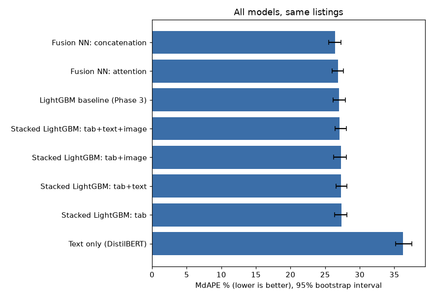

# Evaluation: ablation and significance
_Generated by `python -m src.evalaute`. Do not edit by hand._

5555 listings, Phase 1 folds; every number is out-of-fold, in USD, onn the same listings. Bootstrap: 2000 paired resamples. Significance level 0.05 after Homl correction across 1 comparisons.

## 1. Leaderboard
| model                            | mae_usd | mdape_pct | within_10_pct | within_20_pct | r2_log | ci_low | ci_high |
|----------------------------------|---------|-----------|---------------|---------------|--------|--------|---------|
| Fusion NN: concatenation         | 45.15   | 26.42     | 20.11         | 39.51         | 0.6842 | 25.54  | 27.27   |
| Fusion NN: attention             | 45.31   | 26.84     | 20.05         | 39.19         | 0.6828 | 26.04  | 27.68   |
| LightGBM baseline (Phase 3)      | 45.86   | 26.98     | 19.87         | 38.27         | 0.6756 | 26.19  | 27.93   |
| Stacked LightGBM: tab+text+image | 46.03   | 27.09     | 20.13         | 38.27         | 0.6723 | 26.43  | 28.07   |
| Stacked LightGBM: tab+image      | 46.24   | 27.28     | 19.66         | 38.72         | 0.6694 | 26.22  | 28.1    |
| Stacked LightGBM: tab+text       | 46.2    | 27.33     | 18.87         | 38.07         | 0.6708 | 26.57  | 28.15   |
| Stacked LightGBM: tab            | 46.0    | 27.35     | 19.44         | 38.85         | 0.6745 | 26.35  | 28.15   |
| Text only (DistilBERT)           | 58.71   | 36.25     | 14.82         | 29.2          | 0.4592 | 35.17  | 37.54   |

## 2. Ablation (stacked lightGBM): what does each input add?
| model                            | mae_usd | mdape_pct | within_10_pct | within_20_pct | r2_log | mdape_vs_tab |
|----------------------------------|---------|-----------|---------------|---------------|--------|--------------|
| Stacked LightGBM: tab+text+image | 46.03   | 27.09     | 20.13         | 38.27         | 0.6723 | -0.26        |
| Stacked LightGBM: tab+image      | 46.24   | 27.28     | 19.66         | 38.72         | 0.6694 | -0.07        |
| Stacked LightGBM: tab+text       | 46.2    | 27.33     | 18.87         | 38.07         | 0.6708 | -0.02        |
| Stacked LightGBM: tab            | 46.0    | 27.35     | 19.44         | 38.85         | 0.6745 | 0.0          |

## 3. Significance (B compared with A; negative MdAPE/MAE change = B better)
| question                    | A                     | B                          | mdape_change | mdape_95ci      | p_bootstrap | mae_change | within10_change | p_ttest_logerr | folds_B_wins | p_holm | verdict                    |
|-----------------------------|-----------------------|----------------------------|--------------|-----------------|-------------|------------|-----------------|----------------|--------------|--------|----------------------------|
| Does text add to the table? | Stacked LightGBM: tab | Stacked LightGBM: tab+text | -0.016       | [-0.744, 0.758] | 0.945       | 0.2        | -0.58           | 0.165          | 3/5          | 0.945  | no siginificant difference |

- `p_bootstrap`: paired bootstrap on per-listing errors (primary test).
- `p_ttest_logerr`: paired t-test on per-listing absolute log errors (secondary).
- `p_holm`: bootstrap p adjusted for the number of comparisons; `verdict` uses it.
- `folds_B_wins`: folds in which B had the lower MdAPE.

## 4. Best Model: Fusion NN: concatenation
Per market, compared with the Phase 3 baseline:
| market         | rows | baseline_mdape | best_mdape | change |
|----------------|------|----------------|------------|--------|
| Istanbul       | 660  | 36.98          | 35.93      | -1.05  |
| Montreal       | 648  | 26.78          | 26.33      | -0.45  |
| Barcelona      | 632  | 28.83          | 30.05      | 1.22   |
| Hong Kong      | 619  | 24.73          | 23.13      | -1.6   |
| Sydney         | 609  | 23.48          | 22.02      | -1.46  |
| New York       | 607  | 21.92          | 21.34      | -0.58  |
| Rio De Janeiro | 603  | 38.74          | 38.59      | -0.15  |
| Porto          | 554  | 23.88          | 23.36      | -0.52  |
| Oahu           | 253  | 20.25          | 20.25      | 0.0    |
| Maui           | 153  | 23.96          | 26.81      | 2.85   |
| The Big Island | 139  | 25.76          | 23.63      | -2.13  |
| Kauai          | 67   | 24.26          | 24.86      | 0.6    |
|                | 6    | 28.37          | 21.76      | -6.61  |

## 5. Feature importance of the best stacked model (Stacked LightGBM: tab+text+image, top 20)
| feature                 | gain_pct |
|-------------------------|----------|
| text_pred_log           | 35.28    |
| accommodates            | 6.14     |
| room_type               | 5.71     |
| market                  | 4.22     |
| bathrooms               | 3.54     |
| neighbourhood           | 3.1      |
| longitude               | 2.78     |
| latitude                | 2.42     |
| bedrooms                | 1.97     |
| img_pred_log            | 1.87     |
| text_pc4                | 1.79     |
| days_since_last_review  | 1.66     |
| minimum_nights          | 1.2      |
| img_pc2                 | 1.2      |
| dist_centre_km          | 1.14     |
| days_since_first_review | 1.02     |
| img_pc3                 | 0.96     |
| number_of_reviews       | 0.96     |
| text_pc5                | 0.87     |
| rs_rating               | 0.83     |

## 6. Notes
- Stacking: text/photo predictions are out-of-fold but come from models trained on the other folds (standard practice; can be very slightly optimistic).
- Final model for the web app: `models/stacked/stacked_lightgbm.txt`.
