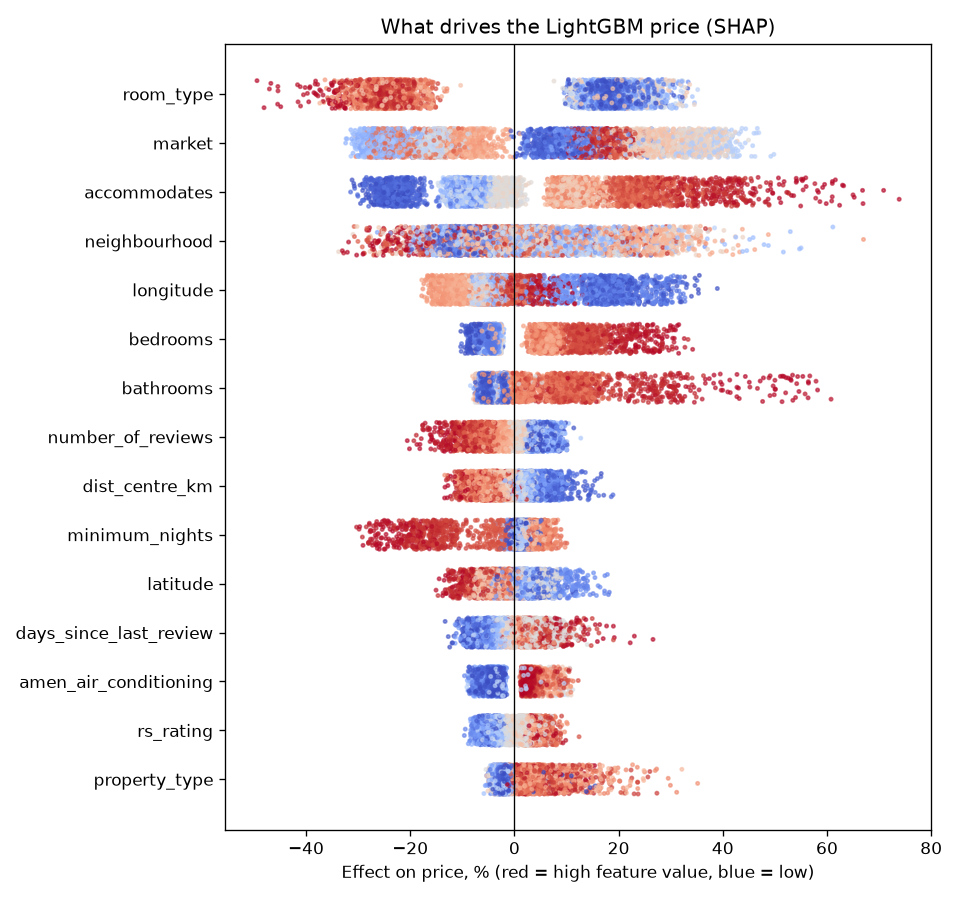

# Explanations: why the model predicts this price1
_Generated by `python -m src.explain`. Do not edit by hand_.

## 1. What drives the price (SHAP, Phase 3 LightGBM)
5555 listings. A typical listing is priced at $76.06; each feature multiplies that up or down. `typical_effect_pct` is the average size of that multiplier. Check: SHAP values add up to the model's prediction (max gap 2.7e-14).

| feature                | mean_abs_shap | typical_effect_pct | direction               |
|------------------------|---------------|--------------------|-------------------------|
| room_type              | 0.2159        | 24.1               | depends on the category |
| market                 | 0.1831        | 20.1               | depends on the category |
| accommodates           | 0.1367        | 14.6               | higher = pricier        |
| neighbourhood          | 0.1028        | 10.8               | depends on the category |
| longitude              | 0.079         | 8.2                | higher = cheaper        |
| bedrooms               | 0.0624        | 6.4                | higher = pricier        |
| bathrooms              | 0.0564        | 5.8                | higher = pricier        |
| number_of_reviews      | 0.043         | 4.4                | higher = cheaper        |
| dist_centre_km         | 0.0399        | 4.1                | higher = cheaper        |
| minimum_nights         | 0.0362        | 3.7                | higher = cheaper        |
| latitude               | 0.0357        | 3.6                | higher = cheaper        |
| days_since_last_review | 0.0342        | 3.5                | higher = pricier        |
| amen_air_conditioning  | 0.0338        | 3.4                | higher = pricier        |
| rs_rating              | 0.0335        | 3.4                | higher = pricier        |
| property_type          | 0.0322        | 3.3                | depends on the category |

## 2. Example listings, explained one by one

**Budget listing**: actual $25.61, predicted $30.2 (typical $76.06)

| feature        | value          | effect_pct |
|----------------|----------------|------------|
| room_type      | Private room   | -21.3      |
| market         | Rio De Janeiro | -20.6      |
| neighbourhood  | Copacabana     | -12.3      |
| accommodates   | 2              | -8.9       |
| longitude      | -43.1885       | -6.2       |
| dist_centre_km | 0.916231       | 6.0        |

**Typical listing**: actual $75.78, predicted $72.56 (typical $76.06)

| feature                 | value           | effect_pct |
|-------------------------|-----------------|------------|
| room_type               | Entire home/apt | 19.8       |
| market                  | Sydney          | 19.3       |
| accommodates            | 2               | -10.5      |
| number_of_reviews       | 230             | -9.1       |
| days_since_first_review | 2095            | 9.2        |
| days_since_last_review  | 3               | -6.0       |

**Premium listing**: actual $199.0, predicted $201.74 (typical $76.06)

| feature                 | value           | effect_pct |
|-------------------------|-----------------|------------|
| market                  | New York        | 40.5       |
| neighbourhood           | Manhattan       | 29.3       |
| longitude               | -73.9971        | 19.3       |
| room_type               | Entire home/apt | 17.7       |
| number_of_reviews       | 208             | -7.5       |
| days_since_first_review | 2324            | 7.7        |

## 3. What the fusion network adds (Integrated Gradients, Captum)
500 random listings, 32, baseline = the average listing. The network starts from the LightGBM price and adds a correction; on average the correction is 5.82% of the price. SHare of the correction from each input:

| listings   | rows | table_pct | text_pct | photo_pct |
|------------|------|-----------|----------|-----------|
| all        | 500  | 17.3      | 35.0     | 47.7      |
| with photo | 414  | 15.8      | 32.3     | 51.8      |
| no photo   | 86   | 34.6      | 65.4     | 0.0       |

Table features with the largest effect on the correction:

| feature                    | mean_abs_effect_pct |
|----------------------------|---------------------|
| amen_family_kid_friendly   | 0.46                |
| amen_dryer                 | 0.42                |
| amen_dishes_and_silverware | 0.35                |
| amen_bed_linens            | 0.31                |
| amen_stove                 | 0.3                 |
| host_identity_verified     | 0.28                |
| beds                       | 0.26                |
| number_of_reviews          | 0.26                |
| rs_cleanliness             | 0.26                |
| rs_value                   | 0.26                |

Completeness check: attributions add up to the change in output to within 0.00%. Categories (market, room type, ...) and the LigthGBM price are held fixed, so they get no share here.

## 4. Notes
- SHAP explains the baseline model on the listings it was trained on (global view); the web app shows the same explanation for each new listing.
- Effects are multiplicative: +20% and -10% together give 1.2 x 0.9 = 1.08 (+8%).
